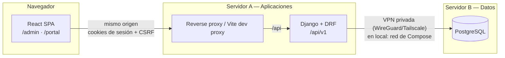
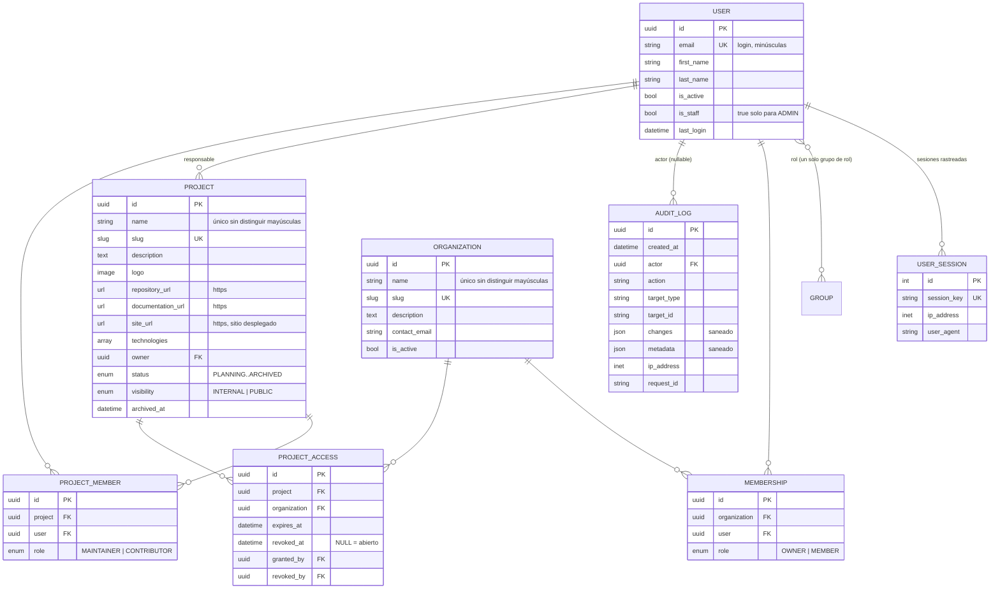

# Arquitectura de DevHub

## Visión general

DevHub es un **monolito modular**: un backend Django/DRF y un frontend React en un monorepositorio.
Las microaplicaciones que DevHub administra son proyectos independientes y **no** forman parte de
este código.

## Decisiones técnicas

| # | Decisión | Justificación |
|---|---|---|
| D1 | **Autenticación con sesiones de Django + CSRF** (no JWT) | El SPA y la API comparten origen (proxy). La cookie de sesión es `HttpOnly` y `SameSite=Lax`, de modo que JavaScript no tiene acceso a los tokens. La revocación es inmediata, borrando la sesión. |
| D2 | **Roles = Django Groups** (`ADMIN`, `DEVELOPER`, `CLIENT`, `VISITOR`), sincronizados en `post_migrate` | Cumple "roles mediante Groups y permisos de Django". Cada usuario tiene un único rol, que gestiona la capa de servicios. |
| D3 | **Autorización en dos niveles**: clases de permiso DRF por rol + `get_queryset` acotado por objeto | Si un recurso no pertenece al usuario, la API devuelve **404**, no 403, para no revelar que existe (protección contra IDOR). El frontend nunca es la barrera de seguridad. |
| D4 | **Capa de servicios** (`apps/*/services.py`) | Las vistas solo validan la entrada y llaman a servicios transaccionales. Ahí viven las reglas de negocio y la auditoría. |
| D5 | **Auditoría inmutable** (`AuditLog`) | `save` (actualización), `delete`, `QuerySet.update` y `QuerySet.delete` lanzan `ImmutableRecordError`. Los datos se sanean antes de guardarse. |
| D6 | **Formato de error único** `{code, detail, fields?}` | El frontend asigna `fields` directamente a los campos de React Hook Form. |
| D7 | **Request ID** (`X-Request-ID`) propagado o generado por petición | Correlación entre logs y auditoría; servirá de base para la trazabilidad (Fase 4). |
| D8 | **Resiliencia de la conexión a BD** | `connect_timeout`, `statement_timeout`, `CONN_HEALTH_CHECKS` y un entrypoint que espera a la BD con límite de tiempo, porque PostgreSQL vivirá en otro equipo vía VPN. |
| D9 | **UUID como clave primaria** en entidades expuestas | Identificadores no enumerables. |
| D10 | **Caché de base de datos** para el rate limiting en producción | Comparte contadores entre los workers de gunicorn sin añadir Redis al MVP. |
| D11 | **Usuarios y organizaciones no se eliminan**: se desactivan | Conserva el historial y la trazabilidad. |

## Modelo de datos (Fases 1–2)

## Roles y permisos (Fases 1–2)

| Recurso / acción | ADMIN | DEVELOPER | CLIENT | VISITOR | Anónimo |
|---|---|---|---|---|---|
| Login / logout / perfil / cambio de contraseña | ✅ | ✅ | ✅ | ✅ | login |
| Recuperación de contraseña | — | — | — | — | ✅ |
| Usuarios: listar, crear, editar, activar/desactivar, revocar sesiones | ✅ | ❌ | ❌ | ❌ | ❌ |
| Organizaciones: crear, editar, activar/desactivar | ✅ | ❌ | ❌ | ❌ | ❌ |
| Organizaciones: consultar | todas | solo propias activas | solo propias activas | solo propias activas | ❌ |
| Membresías: gestionar | ✅ | ❌ | ❌ | ❌ | ❌ |
| Auditoría: consultar | ✅ | ❌ | ❌ | ❌ | ❌ |
| Proyectos: ver | todos | propios o asignados | ❌ | ❌ | ❌ |
| Proyectos: crear, archivar, publicar, responsable, miembros, accesos | ✅ | ❌ | ❌ | ❌ | ❌ |
| Proyectos: editar datos técnicos y logotipo | ✅ | responsable o MAINTAINER | ❌ | ❌ | ❌ |
| Panel `/admin` (UI) | ✅ | ✅ | → portal | → portal | → login |
| Portal `/portal` (UI) | → panel | → panel | ✅ | ✅ | → login |

## Reglas de negocio (Fase 1)

**Usuarios**
1. El correo es el identificador de inicio de sesión. Se guarda en minúsculas y es único.
2. Cada usuario tiene exactamente un rol. Al cambiarlo se reemplaza el grupo anterior.
3. Solo `ADMIN` tiene `is_staff` (acceso al Django admin de soporte).
4. Un administrador no puede cambiar su propio rol ni desactivar su propia cuenta.
5. Debe existir al menos un administrador activo (regla defensiva en la capa de servicios).
6. Al desactivar un usuario se eliminan **todas** sus sesiones activas.
7. Al cambiar la contraseña se mantiene la sesión actual y se cierran las demás.
8. La recuperación de contraseña responde lo mismo exista o no la cuenta (no permite enumerar usuarios). El token es de un solo uso y expira en 1 hora.
9. Un usuario creado sin contraseña tiene una contraseña inutilizable y debe usar la recuperación.
10. Los intentos de login están limitados (`THROTTLE_LOGIN`, por defecto 10/min) y se auditan, tanto los exitosos como los fallidos.

**Organizaciones**
1. El nombre es único sin distinguir mayúsculas. El `slug` se genera automáticamente (con sufijo `-2`, `-3`… si colisiona).
2. Las organizaciones no se eliminan, solo se desactivan.
3. Un usuario no puede pertenecer dos veces a la misma organización.
4. Solo se pueden agregar usuarios activos. Los `VISITOR` no pueden ser miembros.
5. Los usuarios que no son administradores solo ven las organizaciones **activas** a las que pertenecen. Cualquier otro ID devuelve 404.

**Proyectos** — ver las reglas completas en [phase-2.md](phase-2.md#reglas-de-negocio).

**Auditoría**
1. Se registran el inicio y cierre de sesión, los fallos de login, los cambios y la recuperación de contraseña, todas las operaciones administrativas sobre usuarios, organizaciones y membresías, y la revocación de sesiones.
2. Antes de guardar, se redactan las claves sensibles (`password`, `token`, `secret`, `api_key`, `authorization`, `cookie`, `session_id`, `dsn`, `connection_string`…) y los valores con forma de secreto (URLs `postgres://…`, `Bearer …`, tokens `ghp_…`).
3. Los registros son de solo inserción. La política de retención con purga controlada se define en la Fase 4 junto con la trazabilidad.

## Seguridad aplicada en la Fase 1

- CSRF obligatorio en todas las peticiones de escritura, incluidos login y recuperación (`csrf_protect` explícito).
- Cookies `HttpOnly` de sesión. `Secure` y HSTS en producción. `SECURE_PROXY_SSL_HEADER` para operar detrás de Cloudflare y el proxy.
- CORS deshabilitado por defecto (mismo origen). Se habilita solo por lista explícita (`DJANGO_CORS_ALLOWED_ORIGINS`).
- Rate limiting global (anónimo/usuario) y específico para login y recuperación. `DJANGO_NUM_PROXIES` evita falsificar la IP mediante `X-Forwarded-For`.
- Contraseñas con Argon2 y validadores de Django (mínimo 10 caracteres, contraseñas comunes, solo numéricas, similitud con el usuario).
- La configuración de producción no arranca con un `SECRET_KEY` débil.
- La documentación OpenAPI exige autenticación fuera del entorno local.
- Health check público (`/api/v1/health/`) sin información interna.
- Contenedores sin root. PostgreSQL sin puertos publicados. Puertos de desarrollo enlazados solo a `127.0.0.1`.
- Ningún secreto en el repositorio: `.env` está en `.gitignore` y `.env.example` solo contiene marcadores locales.
