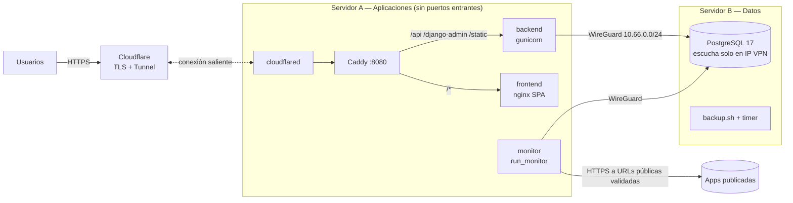

# Fase 6 — Monitoreo y Home Lab

## Alcance

1. **Health checks** periódicos y reales de los entornos publicados (`apps.monitoring` + worker `run_monitor`).
2. **Despliegue Docker** del Home Lab: Servidor A (aplicaciones) y Servidor B (datos), cada uno con su propio compose.
3. **VPN** (WireGuard o Tailscale) entre servidores y firewall de ejemplo.
4. **Cloudflare Tunnel** como única entrada pública. No se abre ningún puerto entrante.
5. **Scripts** de operación (`scripts/`).
6. **Backups** con verificación de integridad, restauración probada y rotación.
7. **CI/CD**: integración continua y despliegue controlado al Home Lab.
8. **Pruebas de conectividad y recuperación**.

La guía operativa paso a paso está en [homelab.md](homelab.md).

## Monitoreo

### Modelos

| Modelo | Campos | Notas |
|---|---|---|
| `HealthCheck` | `environment` (1:1), `path`, `expected_status_min/max` (200–399), `interval_seconds` (300), `timeout_seconds` (5), `degraded_threshold_ms` (2000), `failure_threshold` (2), `enabled`, `status`, `last_checked_at`, `last_response_ms`, `last_status_code`, `last_error`, `consecutive_failures`, `status_changed_at` | La URL objetivo es `environment.public_url` + `path`; **nunca** una URL libre. |
| `CheckResult` | `health_check`, `checked_at`, `status`, `response_ms`, `status_code`, `error` | Histórico. Se purga a los `CHECK_RESULT_RETENTION_DAYS` (30 días). |

### Reglas de negocio

1. **Qué se monitorea.** Solo entornos activos, con URL pública validada (Fase 3: https, dominio público, lista permitida opcional), de proyectos no archivados. Se admite un health check por entorno y el usuario solo elige la **ruta** (`/`, `/health`…), no el host.
2. **Defensas contra SSRF** (`probe.py`):
   - El DNS se resuelve **en el momento de la verificación**. Se rechaza cualquier dirección privada, loopback, link-local (incluido `169.254.169.254`), CGNAT, multicast, reservada o IPv4-mapeada, aunque la URL pasara la validación al guardarse.
   - La conexión se hace a la **IP ya validada** (anti DNS rebinding), con SNI y verificación del certificado para el nombre original.
   - Solo puertos de `MONITOR_ALLOWED_PORTS` (por defecto 443, 8443).
   - **No se siguen redirecciones**, y se leen como mucho 64 KB de respuesta.
   - Si el DNS falla, el destino no está caído: se registra «DNS: no se pudo resolver host» como fallo de conexión.
3. **Estado y antirrebote.**
   - Si la conexión funciona y el código HTTP está en el rango esperado, el estado es `HEALTHY`. Si la respuesta tarda más de `degraded_threshold_ms`, es `DEGRADED`.
   - Ante un fallo (conexión, timeout o código fuera de rango), el estado pasa a `DEGRADED` mientras `consecutive_failures < failure_threshold`, y a `UNAVAILABLE` al alcanzar el umbral.
   - Un único éxito recupera el servicio.
4. **Datos obsoletos.** Si la última verificación tiene más de `max(3 × intervalo, 180 s)`, el estado efectivo es `UNKNOWN` («Verificación desactualizada»). Si el worker se detiene, DevHub **no** sigue mostrando «Disponible».
5. **Eventos de trazabilidad.**
   - Al pasar a `UNAVAILABLE` se emite `SERVICE_UNAVAILABLE`: `CRITICAL` en Production y `ERROR` en el resto.
   - Al salir de `UNAVAILABLE` se emite `SERVICE_RECOVERED`, con `downtime_seconds`.
   - Fuente `MONITORING`. La metadata es saneada y no contiene cabeceras ni cuerpos de respuesta.
   - Cada verificación actualiza `Server.last_checked_at` del servidor del entorno.
6. **Verificación manual** (*Verificar ahora*): la puede lanzar el editor del proyecto (ADMIN, responsable o MAINTAINER), como máximo una vez cada `MONITOR_MANUAL_MIN_SECONDS` (30 s; si no, devuelve `too_soon`), y no en checks desactivados.
7. **Disponibilidad para clientes.** El portal muestra el check de Production o, si no existe, el de Demo. Puede indicar «Sin monitoreo», «Pendiente de verificar», «Verificación desactualizada» o el estado real. No expone la URL, los tiempos ni los errores.
8. **Disponibilidad (uptime).** Es el porcentaje de verificaciones `HEALTHY` o `DEGRADED` en 24 h y 7 días. Sin datos, vale `null` y se muestra «—», nunca 100 %.
9. **Validación de la configuración.**
   - Intervalo ≥ `MONITOR_MIN_INTERVAL_SECONDS` (60).
   - Timeout entre 1 y 10 s, y menor que el intervalo.
   - Rango HTTP entre 100 y 599, con mínimo ≤ máximo.
   - Umbral de fallos entre 1 y 10.
   - La ruta empieza por `/`, sin esquema, host, `..`, `\`, espacios ni caracteres de control.
10. **Auditoría.** Se auditan `HEALTH_CHECK_CREATED` y `HEALTH_CHECK_UPDATED`, y la configuración también emite `CONFIGURATION_CHANGED`.

### Worker `run_monitor`

- Proceso independiente: es el servicio `monitor` en ambos compose.
- Cada `MONITOR_LOOP_SECONDS` (15 s) toma hasta `MONITOR_MAX_PER_PASS` checks vencidos y los verifica en paralelo (`MONITOR_MAX_WORKERS` = 8). Las peticiones de red van fuera de transacción; el resultado se escribe con `SELECT … FOR UPDATE`.
- Si la base de datos no está disponible, registra «base de datos no disponible; reintentando» y continúa (`close_old_connections`). No se cae.
- Su healthcheck de Docker consiste en un archivo de *heartbeat* que se actualiza en cada vuelta. Atiende `SIGTERM` de forma ordenada.
- Con `--once` ejecuta una sola pasada, útil para diagnóstico.

### Endpoints (`/api/v1/`)

| Método | Ruta | Acceso | Descripción |
|---|---|---|---|
| GET | `health-checks/` | personal (alcance por proyecto) | Filtros `project`, `environment`, `status`, `enabled`, `search` |
| POST | `health-checks/` | editor del proyecto | Crear (`environment`, `path`, umbrales…) |
| GET / PATCH | `health-checks/{id}/` | ver: personal; editar: editor | Incluye `effective_status`, `is_stale`, `uptime_24h`, `uptime_7d`, `can_edit` |
| POST | `health-checks/{id}/run/` | editor del proyecto, límite de 30 s | Verificación inmediata real |
| GET | `health-checks/{id}/results/?hours=1..168` | personal | Serie para la gráfica (máx. 2000 puntos) |
| GET | `monitoring/summary/` | personal | Totales por estado efectivo, obsoletos, entornos sin monitoreo |

Los clientes no tienen acceso (403), y un check de un proyecto ajeno devuelve 404.

### Frontend

- `/admin/monitoring`: KPIs por estado, tabla con estado, respuesta, disponibilidad en 24 h, última verificación y *Verificar ahora*, búsqueda y alta de health checks.
- `/admin/monitoring/:id`: disponibilidad en 24 h y 7 días, configuración, gráfica de tiempo de respuesta (24 h / 7 días; los puntos marcan verificaciones degradadas o fallidas), tabla de últimas verificaciones y aviso de datos obsoletos.
- La tarjeta de entornos del proyecto muestra el estado de cada entorno. El portal muestra la disponibilidad real.
- El estado se muestra siempre con icono y texto, no solo con color, y se refresca cada 30 s.

## Home Lab

| Elemento | Archivo | Decisiones |
|---|---|---|
| Servidor A | `infrastructure/compose/server-a.compose.yaml` (proyecto `devhub-app`) | `read_only`, `cap_drop: [ALL]`, `no-new-privileges`, usuarios sin root y límites de memoria. **Solo** el proxy publica un puerto, y en `127.0.0.1`. `cloudflared` va en el perfil `tunnel`. No se monta el socket de Docker. |
| Servidor B | `infrastructure/compose/server-b.compose.yaml` (proyecto `devhub-data`) | PostgreSQL publica solo en `${VPN_BIND_IP}` (obligatorio, nunca `0.0.0.0`). `pg_hba.conf` se genera desde una plantilla con `DB_ALLOWED_CIDR` y `scram-sha-256`, y rechaza todo lo demás. |
| Proxy | `infrastructure/proxy/Caddyfile` | Reparte API/static/admin → backend, `/media` → archivos con CSP `sandbox`, resto → SPA. Cabeceras de seguridad, límite de 5 MB por petición y `/healthz`. |
| VPN | `infrastructure/vpn/wireguard/*.conf.example`, `firewall-server-*.sh` | Ejemplos con la subred `10.66.0.0/24`. El firewall solo admite PostgreSQL desde la VPN. |
| Túnel | `CLOUDFLARE_TUNNEL_TOKEN` (modo dashboard) o `infrastructure/cloudflare/config.example.yml` (modo local) | Solo conexiones salientes; el resto devuelve `http_status:404`. |
| Tareas | `infrastructure/systemd/devhub-backup.*`, `devhub-purge.*` | Backup diario (Servidor B) y purga semanal (Servidor A). |
| Bases por aplicación | `scripts/create-app-db.sh --app NOMBRE` | Rol `app_<nombre>` y base propia, `REVOKE CONNECT FROM PUBLIC`, contraseña mostrada una sola vez y `--rotate`. |

**Proxies de confianza:** con cloudflared y Caddy delante, `DJANGO_NUM_PROXIES=2`. Así la IP del cliente que usan el rate limiting y la auditoría es la que añade Cloudflare, no una falsificable.

## Scripts

| Script | Función |
|---|---|
| `setup.sh --server a\|b` | Comprueba las herramientas y genera el archivo env con secretos aleatorios (`chmod 600`). Nunca sobrescribe un archivo existente. |
| `build.sh [--tag]` | Construye las imágenes, etiquetadas con el commit. |
| `migrate.sh` | Aplica migraciones con un contenedor efímero. |
| `deploy.sh [--tag] [--skip-build] [--tunnel]` | Construye, migra, ejecuta `up -d --wait` y comprueba la salud. Usa un *lock* y es repetible. Con `--tunnel` exige el token. |
| `healthcheck.sh [URL]` | Consulta la salud con reintentos. Devuelve 0 si el servicio está sano y 1 si no. |
| `status.sh` | Muestra el estado y la salud de los contenedores. |
| `backup.sh` | `pg_dump -Fc` por base más los *globals*, `SHA256SUMS`, cifrado `age` y copia `rclone` opcionales, y rotación. Usa un *lock*. |
| `restore.sh --verify \| --db NOMBRE` | Verifica el checksum. `--verify` restaura en una base temporal y la elimina. La restauración real exige escribir «RESTAURAR <db>» o pasar `--yes`, y falla sin TTY. |
| `create-app-db.sh` | Base y rol aislados por aplicación. |
| `devhub-deploy-report.sh` | Reporta despliegues desde CI a DevHub (Fase 4). |

Todos usan `set -euo pipefail` y leen el archivo env **sin ejecutarlo** (`load_env_file`), y ninguno imprime secretos. Pasan ShellCheck.

## CI/CD

- **`.github/workflows/ci.yml`** se ejecuta en `push` y `pull_request` con `permissions: contents: read` y sin secretos:
  - backend: ruff, pytest contra PostgreSQL real, validación OpenAPI y `pip-audit`;
  - frontend: lint, typecheck, Vitest, build y `npm audit`;
  - scripts: ShellCheck y `docker compose config` de ambos servidores;
  - imágenes: build y escaneo con Trivy.
- **`.github/workflows/deploy-demo.yml`** solo se lanza con `workflow_dispatch` y solo desde `main`.
  - Se ejecuta en un *self-hosted runner* del Servidor A (etiqueta `homelab`, solo con conexiones salientes) con el *environment* `demo`, que debe tener revisores obligatorios.
  - Una contribución externa (PR o fork) **no** puede dispararlo.
  - El texto introducido llega por variable de entorno, nunca interpolado en el script.
  - Reporta el inicio y el resultado del despliegue a DevHub con un token de servicio.
- `actionlint.yaml` declara la etiqueta del runner. `dependabot.yml` actualiza pip, npm, Docker y Actions.

## Verificación realizada

### Pruebas automatizadas

| Suite | Resultado |
|---|---|
| Backend: `pytest` (PostgreSQL real) | **248 passed** (43 de monitoreo: SSRF, IP fijada, fallo DNS, transiciones, obsolescencia, portal, permisos, límite manual, uptime, worker transaccional, purga, 503) |
| Backend: `ruff check`, `ruff format --check`, `spectacular --validate --fail-on-warn` | OK |
| Frontend: `tsc`, `eslint`, Vitest (**75 passed**), `vite build` | OK |
| ShellCheck (scripts + firewall), actionlint (workflows) | Sin hallazgos |

### Pruebas reales (no simuladas)

| Escenario | Resultado |
|---|---|
| Verificación real de `https://example.com` | HTTP 200, ~300–700 ms, `HEALTHY` |
| Destinos internos disfrazados (`localtest.me`, `10.0.0.1.nip.io`, `169.254.169.254.nip.io`) | Rechazados **antes** de conectar |
| Dominio sin DNS (`pedidos.girlofthecodes.dev`) | `UNAVAILABLE` con «DNS: no se pudo resolver host» |
| Caída controlada (rango HTTP imposible) y restauración | `DEGRADED` → `UNAVAILABLE`, `SERVICE_UNAVAILABLE` CRITICAL; luego `SERVICE_RECOVERED` con 33 s de caída |
| Worker detenido | El panel y el portal pasan a «Verificación desactualizada» y se recuperan al reiniciar |
| Home Lab simulado en un solo equipo (Servidor B en `127.0.0.1:55432`, Servidor A en `127.0.0.1:8088`) | `setup.sh` idempotente. `deploy.sh` ejecutado dos veces sin cambios. Salud, SPA y estáticos devuelven 200 a través de Caddy, con las cabeceras de seguridad presentes. Solo el proxy publica un puerto. |
| Configuración de producción | Cookies `Secure` + `HttpOnly` + `SameSite=Lax`. OpenAPI responde 403 a anónimos. |
| Bases por aplicación | `app_pedidos` no puede conectarse a `devhub`; una contraseña incorrecta se rechaza |
| **Caída del Servidor B** (PostgreSQL detenido) | La salud responde 503 `database: unavailable` y la API 503 `database_unavailable` (no 500). Los contenedores del Servidor A siguen en ejecución, el monitor reintenta y todo se recupera solo, sin perder la sesión (9/9). |
| Backup | Dos bases más los *globals* y `SHA256SUMS` |
| `restore.sh --verify` | 28 tablas y 33 migraciones; la base temporal se elimina |
| Respaldo alterado | Rechazado por checksum |
| Restauración sin TTY | Rechazada |
| Restauración real (`--yes`) | Desaparece el proyecto creado después del backup y la aplicación sigue sana |
| Rotación | Se eliminó un backup fechado artificialmente hace 30 días, fuera de `BACKUP_RETENTION_DAYS` |

### Errores encontrados y corregidos durante la verificación

- Un fallo de DNS se trataba como «destino rechazado». Se separó en `ProbeDNSError` y ahora se registra como caída real.
- El nombre de proyecto de compose coincidía con el de desarrollo. Se renombró a `devhub-app` y `devhub-data`.
- Caddy no arrancaba con `cap_drop: ALL`. Se añadió `cap_add: NET_BIND_SERVICE`.
- El *health check* activo de Caddy recibía 400 porque enviaba `Host: backend:8000`. Se dejó solo el pasivo; Docker ya vigila el backend.
- La generación de secretos producía SIGPIPE con `pipefail`, y el carácter `=` rompía el formato env. Se corrigieron ambos.
- `sha256sum` en modo binario (`*archivo`) no se reconocía. Ahora se interpretan ambos formatos.
- El workflow de despliegue interpolaba la entrada del usuario en el script. Ahora pasa por variable de entorno.
- Las rutas MSYS en Git Bash se resolvían mal para `docker.exe`. Se resolvió con `pwd -W`.

## Qué requiere infraestructura real (preparado, no ejecutable aquí)

| Pendiente | Qué falta | Dónde está preparado |
|---|---|---|
| VPN entre dos equipos | Dos hosts Linux y claves WireGuard (o una cuenta de Tailscale) | `infrastructure/vpn/` |
| Cloudflare Tunnel | Cuenta de Cloudflare, dominio y token del túnel | `CLOUDFLARE_TUNNEL_TOKEN`, `infrastructure/cloudflare/` |
| Despliegue desde GitHub | Repositorio en GitHub, *self-hosted runner* en el Servidor A, *environment* `demo` con revisores y secretos `DEVHUB_URL` / `DEVHUB_TOKEN` | `.github/workflows/deploy-demo.yml` |
| Correo de recuperación | Credenciales SMTP | `server-a.env` |
| Copia de backups fuera del equipo | Remoto rclone (B2, S3…) y opcionalmente una clave `age` | `BACKUP_REMOTE`, `BACKUP_AGE_RECIPIENT` |
| Timers systemd | Hosts Linux con systemd | `infrastructure/systemd/` |

Los archivos de VPN, firewall, Cloudflare y systemd están marcados como **EJEMPLO**: su sintaxis es la documentada por cada herramienta, pero no se han ejecutado en hosts reales.
