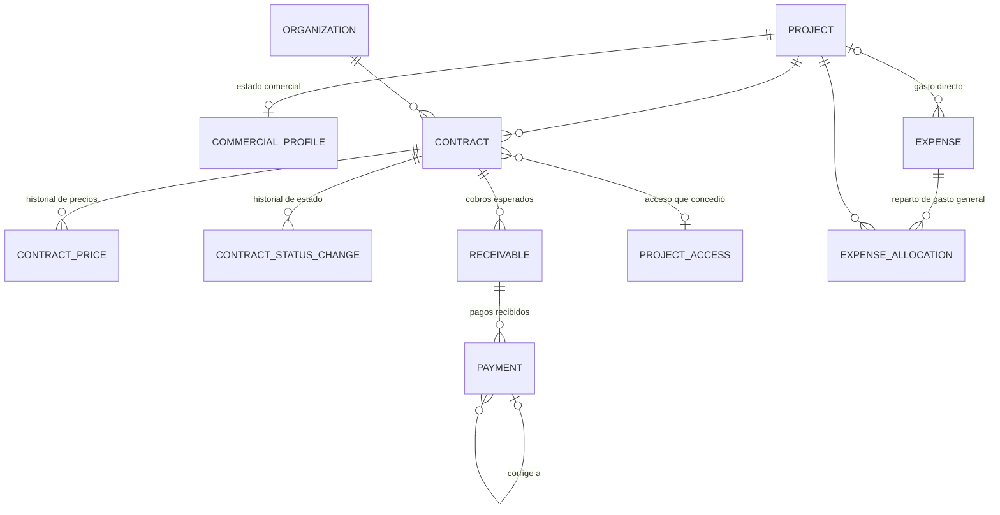

# Fase 7: accesos por portal y gestión comercial

La fase tiene dos bloques:

- **A.** Separa el acceso administrativo del portal de clientes, en la interfaz y en el servidor.
- **B.** Agrega la capa comercial sobre el catálogo de proyectos existente: contratos de venta y renta, cobros, pagos, gastos, rentabilidad, MRR y ARR.

No se creó un segundo catálogo de aplicaciones ni un segundo sistema de autenticación.

## Bloque A: autenticación y accesos

### Qué cambió

| Antes | Ahora |
|---|---|
| `/` redirigía al login | `/` muestra la pantalla de bienvenida con dos tarjetas: «Acceso administrativo» y «Acceso de clientes» |
| `/login` y `/portal/login` usaban el mismo endpoint `POST /auth/login/` | `POST /auth/admin/login/` y `POST /auth/client/login/`; el endpoint genérico se eliminó (404) |
| Un admin podía iniciar sesión desde el login del portal | El servidor valida el portal antes de crear la sesión |
| Portal de clientes en `/portal/*` | Portal en `/cliente/*`; las URL antiguas `/portal/*` y `/login` redirigen a las nuevas |

La autenticación sigue siendo por sesión de Django con CSRF y cookies `HttpOnly` y `SameSite=Lax` (en producción además `Secure`).

### Política de acceso por portal (`apps/users/portals.py`)

| Portal | Quién entra | Rol efectivo en la sesión |
|---|---|---|
| Panel administrativo | ADMIN o DEVELOPER activos | su rol interno |
| Portal de clientes | Usuarios activos del grupo CLIENT, sea como rol principal o como acceso adicional. VISITOR conserva su inicio de solo portafolio, como antes. | CLIENT (o VISITOR) |

- **Sesión ligada al portal.** Al iniciar sesión se guarda `devhub_portal` en la sesión. `PortalSessionAuthentication`, la autenticación DRF por defecto, fija el rol efectivo de cada petición según ese portal. Así, una sesión abierta en el portal de clientes recibe 403 en todos los endpoints del panel, y al revés, aunque se manipulen rutas o peticiones HTTP. La interfaz nunca decide permisos (no usa localStorage para esto).
- **Usuario con ambos accesos (caso 6).** El administrador puede marcar «También puede entrar al portal de clientes» en un ADMIN o DEVELOPER. El usuario entra a cualquiera de los dos portales, pero cada sesión queda limitada al portal desde el que inició sesión. Iniciar sesión en el otro portal cierra la sesión anterior.
- **Cambios de acceso con sesión abierta.** Si se retira el acceso de cliente o se cambia el rol, el cambio aplica desde la siguiente petición de esa sesión.
- **Usuario desactivado.** Recibe «Correo o contraseña incorrectos.» en ambos portales, el mismo mensaje genérico de siempre, para no revelar que la cuenta existe.
- **Mensajes de rechazo por portal.** Solo se muestran tras validar la contraseña: «Tu cuenta no tiene acceso al portal de clientes.» y «Tu cuenta no tiene permisos para acceder al panel administrativo.».
- **Auditoría.** Los rechazos se registran como `LOGIN_FAILED` con `reason=portal_not_allowed`.
- **Sesión expirada o cierre de sesión.** Se vuelve al login del portal correspondiente.

## Bloque B: gestión comercial y rentabilidad

### Modelo de datos (`apps/commercial`)

- **Identificadores y dinero.** Todos los modelos usan UUID. El dinero se guarda en `DecimalField(14,2)`, nunca en float, siempre con su moneda (MXN por defecto, USD disponible). La API devuelve los importes como texto con dos decimales.
- **Restricciones en la base de datos:**
  - un solo contrato abierto (borrador, pendiente, activo o suspendido) por proyecto, organización y modelo comercial;
  - la periodicidad corresponde al modelo (una venta no tiene periodicidad y una renta sí);
  - la fecha de fin no puede ser anterior a la de inicio;
  - todos los importes son positivos;
  - un cobro por periodo;
  - referencia de pago única por método mientras el pago no esté revertido;
  - reparto de gastos entre 0 y 100 %.
- **Estado técnico y estado comercial.** El estado técnico del proyecto no cambia. El estado comercial vive en `CommercialProfile`: *No comercializable* (por defecto), *En preparación*, *Disponible para venta*, *para renta*, *para venta y renta* o *Comercialización suspendida*. Solo se pueden crear contratos de los modelos que permite el estado comercial; los contratos existentes no se tocan.
- **Usuarios finales.** Es un dato informativo capturado a mano. No entra en ningún cálculo, y DevHub no consulta las tablas de las aplicaciones.
- **Migración.** `commercial/0001_initial` solo agrega tablas nuevas y no modifica ni borra datos existentes.

### Reglas de negocio

1. **Contratos.** Siguen el ciclo Borrador → Pendiente → Activo ⇄ Suspendido → Finalizado o Cancelado.
   - La fecha efectiva de cada cambio no puede ser futura ni anterior al cambio previo, para no reescribir la historia.
   - Cancelar exige un motivo.
   - Los contratos nunca se borran (la API no permite DELETE).
2. **Edición de contratos.**
   - En borrador o pendiente se puede editar todo mientras no haya cobros.
   - Activo o suspendido: solo condiciones, fecha de fin, visibilidad, acceso y próxima fecha de cobro.
   - El precio de una renta cambia con **«Cambiar precio»**, que agrega una fila al historial vigente desde hoy o una fecha futura. Nunca es retroactivo, así que el MRR de meses pasados no cambia.
3. **Política de acceso al portal.**
   - Un contrato en borrador **no** concede acceso.
   - Al **activarse** (si «habilita acceso» está marcado) crea un `ProjectAccess` que expira al final del último día del contrato.
   - Al **cancelarse o finalizar** revoca solo el acceso que él mismo creó. Si otro contrato activo de la misma organización también da acceso, ese contrato toma el acceso en lugar de revocarlo.
   - Un acceso concedido manualmente nunca se revoca por un contrato.
   - **Suspender no revoca el acceso**, y un retraso de pago no suspende nada automáticamente.
   - Las acciones quedan auditadas como «Acceso comercial concedido» y «Acceso comercial revocado».
4. **Cobros (lo esperado).**
   - Rentas: «Generar siguiente periodo» crea el cobro del periodo con el precio vigente al inicio de ese periodo y avanza la próxima fecha de cobro.
   - Ventas: se programan uno o varios cobros cuya suma no puede superar el importe de la venta.
   - Estados: Pendiente, Parcial, Pagado o Cancelado. **Vencido** nunca se guarda: se calcula como pendiente o parcial con vencimiento anterior a hoy, según la zona horaria `BUSINESS_TIME_ZONE` (por defecto America/Mexico_City).
5. **Pagos (lo cobrado).**
   - El registro es manual; no hay pasarela de pago.
   - Al registrar un pago se bloquea la fila del cobro (`select_for_update`), así que dos pagos simultáneos no pueden superar el saldo.
   - No se aceptan pagos con fecha futura ni sobrepagos, y una referencia repetida se rechaza.
   - Un pago confirmado nunca se edita ni se borra: se **revierte** (con motivo) o se **corrige**, lo que revierte el original y registra el nuevo pago enlazado.
6. **Cierre de contrato.** Cancelar o finalizar cancela los cobros futuros que no tienen pagos. Lo que ya venció o está parcialmente pagado se conserva porque sigue adeudado.
7. **Gastos.**
   - Se reconocen en su fecha. Los recurrentes se registran en cada ocurrencia y el sistema nunca los proyecta.
   - Sin proyecto, un gasto es **general**. Se reparte a las aplicaciones con porcentajes explícitos que suman como máximo 100 %; lo no asignado queda como general.
   - El total del portafolio cuenta cada gasto **una sola vez**.
   - Los gastos se anulan con motivo; nunca se borran.
8. **Monedas.** Nunca se suman entre sí. Cada indicador es de una moneda, y la API avisa (`other_currencies`) si hay movimientos en otra.

### Cálculos (`apps/commercial/metrics.py`, única fuente)

| Indicador | Definición |
|---|---|
| Ingresos cobrados | Pagos confirmados (no revertidos) con fecha de pago en el periodo |
| Ingresos esperados | Cobros no cancelados con vencimiento en el periodo |
| Pagos vencidos | Saldo de cobros pendientes o parciales con vencimiento anterior a hoy (independiente del periodo) |
| Gastos | Gastos no anulados del periodo. Por proyecto: los directos más su porcentaje de los generales. |
| Ganancia operativa estimada | Cobrado − gastos. Es una estimación operativa, no utilidad contable ni fiscal (se indica en pantalla). |
| Margen | Ganancia ÷ cobrado × 100. Con cobrado = 0 se muestra «No disponible»; no se divide entre cero. |
| MRR en una fecha | Suma, sobre rentas **activas y vigentes** en esa fecha, del precio vigente ÷ meses del periodo (1, 3, 6 o 12) |
| ARR | MRR × 12 |
| MRR histórico | Foto al cierre de cada mes (el mes en curso, a hoy) usando el historial de estado y de precios |
| Crecimiento | (MRR actual − MRR del cierre del mes anterior) ÷ MRR anterior × 100. Con MRR anterior = 0 se muestra «N/A» o «Nuevo ingreso recurrente». |
| Movimientos del MRR | Nuevas, reactivaciones, incrementos, reducciones, suspensiones y cancelaciones; su suma es exactamente la variación del MRR |
| Ingreso recurrente promedio | MRR ÷ contratos recurrentes activos (no se divide entre usuarios finales) |

- **Exclusiones del MRR.** Quedan fuera las ventas únicas, los borradores y pendientes, los cancelados o finalizados, los contratos que aún no inician o ya vencieron, y los **suspendidos**. Estos últimos se reportan aparte («N suspendido(s), fuera del MRR»).
- **Contratado frente a cobrado.** El MRR es un valor mensual contratado, no dinero cobrado; la pantalla los muestra por separado.
- **Filtros.** Mes, trimestre, año o rango personalizado, más aplicación, modelo comercial y moneda. Los resultados siempre salen de los movimientos reales del periodo y nunca se multiplican.
- **Filtro por modelo comercial.** Los gastos no se atribuyen a un modelo, así que con ese filtro gastos, ganancia y margen se muestran como «No aplica» en lugar de una cifra engañosa.

### Permisos

- **Acceso al módulo.** Restringido a ADMIN y a desarrolladores con permiso **explícito por usuario**:
  - `commercial.view_finance` (consulta);
  - `commercial.manage_finance` (gestión).
- **Desarrolladores.** No reciben estos permisos por rol. Se asignan en *Usuarios → Editar → Acceso financiero* y se retiran automáticamente si el usuario deja de ser DEVELOPER.
- **Clientes, visitantes y anónimos.** Siempre reciben 403.
- **Portal de clientes.** `GET /portal/contracts/` devuelve solo los contratos de las organizaciones del cliente que estén marcados como «visible en el portal» y estén activos, suspendidos o finalizados. Muestra la aplicación, la modalidad, la vigencia y el próximo vencimiento, sin importes, costos, márgenes ni contratos de otros clientes.
- **Auditoría.** Los movimientos financieros quedan en la auditoría, que solo pueden ver los administradores. No se emiten eventos de trazabilidad con datos financieros, porque esos eventos los leen todos los miembros de un proyecto.

### API (`/api/v1/commercial/`, todos con permiso financiero)

| Endpoint | Uso |
|---|---|
| `GET applications/` · `GET applications/{id}/` | Catálogo de proyectos con estado comercial, contratos activos y MRR |
| `PATCH applications/{id}/profile/` | Estado comercial, notas y usuarios finales (informativo) |
| `GET applications/{id}/profitability/` | Rentabilidad, MRR/ARR, series e historial de MRR de la aplicación |
| `GET/POST contracts/` · `GET/PATCH contracts/{id}/` | Contratos (filtros: proyecto, organización, modelo, estado, moneda, búsqueda) |
| `POST contracts/{id}/transition/` · `change-price/` · `generate-receivable/` | Cambiar estado, cambiar precio, generar el siguiente periodo |
| `GET/POST receivables/` · `PATCH receivables/{id}/` · `POST …/cancel/` | Cobros (estado incluye `OVERDUE` y `OPEN`; filtros por vencimiento) |
| `GET/POST payments/` · `POST payments/{id}/reverse/` · `…/correct/` | Pagos (sin PUT ni DELETE) |
| `GET/POST expenses/` · `PATCH expenses/{id}/` · `POST …/void/` · `PUT …/allocations/` | Gastos y reparto de gastos generales |
| `GET summary/` | Indicadores globales, series mensuales, rentabilidad por aplicación y mezcla venta/renta |
| `GET recurring/` | MRR, ARR, crecimiento, por aplicación, historial y movimientos |
| `GET upcoming/` | Próximos cobros, vencidos y contratos por terminar |
| `GET /api/v1/portal/contracts/` | Contratos visibles del cliente (solo sesión de cliente) |

Todos los endpoints de métricas aceptan `date_from`, `date_to`, `currency`, `project` y `kind`, con validación: rango máximo de 5 años, moneda y modelo válidos, proyecto existente. El esquema OpenAPI valida sin advertencias.

### Interfaz

- **Navegación.** La sección **Negocio y Rentabilidad** solo aparece con permiso financiero. Incluye:
  - **Resumen:** 12 indicadores del negocio y 10 de ingresos recurrentes, gráficas, aplicaciones más rentables y con mayor MRR, próximos cobros y contratos activos o por terminar.
  - **Aplicaciones comerciales**.
  - **Contratos**, con detalle, acciones de estado, historial de precios y de estado, cobros y pagos.
  - **Cobros:** programados y pagos recibidos.
  - **Gastos:** con reparto de gastos generales.
  - **Reportes:** resultado mensual, rentabilidad por aplicación, desglose de gastos y movimientos del MRR.
- **Detalle de proyecto.** Nueva pestaña **Comercial / Rentabilidad** (solo con permiso financiero). Muestra:
  - estado y modalidades;
  - MRR, ARR, contratos y organizaciones;
  - ingreso recurrente promedio;
  - cobrado, esperado, gastos, ganancia y margen;
  - gráficas;
  - próximos vencimientos, clientes, historial de rentas y ventas, y gastos;
  - acciones para registrar contratos y gastos.
- **Portal de clientes.** Nueva sección **Mis contratos**.
- **Gráficas.** Todas tienen leyenda, tooltip y vista de tabla equivalente. Los colores pasan el validador de paleta (CVD y contraste) en modo claro y oscuro. Sin datos muestran «Sin datos suficientes» en lugar de valores simulados.

## Cambios fuera del módulo (justificados)

| Archivo | Motivo |
|---|---|
| `users/models.py`, `portals.py`, `authentication.py`, `views.py`, `urls.py`, `serializers.py`, `services.py`, `schema.py` | Login por portal, rol efectivo por sesión, acceso de cliente adicional y permiso financiero por usuario |
| `users/roles.py`, `users/apps.py` | El grupo ADMIN recibe los permisos financieros; se admiten permisos personalizados en la sincronización de roles |
| `common/permissions.py` | `HasFinanceAccess` y `finance_access_level` |
| `audit/models.py` | 18 acciones nuevas (el campo no tiene choices en la BD: sin migración) |
| `tests/conftest.py` | Se limpia la caché entre pruebas para aislar los contadores de throttling |
| `frontend/.../UserMenu.tsx` | Al cerrar sesión, el menú se renderizaba sin usuario y lanzaba un error, que React Router capturaba. Ahora no se renderiza. |
| `frontend/.../ProjectDetailPage.tsx`, `router.tsx`, `navigation.ts`, `AdminLayout.tsx`, `PortalLayout.tsx` | Pestaña, rutas y navegación nuevas; rutas `/portal` → `/cliente` |

## Verificación realizada

### Automatizada

| Prueba | Resultado |
|---|---|
| Backend (pytest contra PostgreSQL real) | **370 pasan.** Antes eran 248; se agregaron 23 de accesos por portal (`test_portal_auth.py`), 28 de cálculos (`test_commercial_metrics.py`) y 71 de operaciones, integridad, permisos y portal (`test_commercial.py`). |
| Backend: ruff, ruff format, `spectacular --validate --fail-on-warn`, `makemigrations --check` | Sin errores ni cambios pendientes |
| Frontend: typecheck, ESLint, build | Sin errores |
| Frontend: Vitest | **96 pasan.** Antes eran 75; se agregaron bienvenida, login por portal, permisos en el formulario de usuarios, módulo comercial y contratos del portal. |

- **Cobertura de las pruebas obligatorias.** Las 16 pruebas obligatorias de B.15 y las 16 de B.7.7 están cubiertas, entre otras:
  - normalización mensual, trimestral, semestral y anual;
  - el ejemplo de la especificación (MRR = $9,000);
  - venta, cancelado, futuro y suspendido excluidos;
  - cambio de precio no retroactivo;
  - histórico con movimientos que suman exactamente la variación;
  - ARR global;
  - crecimiento, y crecimiento con mes anterior en cero;
  - cobrado frente a contratado;
  - pagos parciales y vencidos;
  - gastos compartidos sin duplicar;
  - ganancia y margen;
  - periodo sin ingresos;
  - duplicados de contrato y de pago;
  - aislamiento financiero y portal sin importes.

### E2E contra el stack en ejecución (HTTP real, sesiones y CSRF)

**37 de 37 verificaciones pasaron:**

- **Casos 1 a 4 de acceso.**
- **Endpoint genérico eliminado.**
- **Renta de $1,200 mensuales para Acme.**
  - Sin duplicado.
  - Activación y cobro del periodo.
  - Pago parcial de $500 y luego de $700 (resultado: pagado).
  - Referencia duplicada y sobrepago rechazados.
- **Venta de $30,000 a otra organización.** Cobros limitados al importe de la venta.
- **Gastos.** Directo de $2,500 y general de $1,000, este último repartido al 50 %.
- **Octubre de 2026, portafolio.** Cobrado $31,200, gastos $3,500, ganancia $27,700, margen 88.78 %.
- **Octubre de 2026, aplicación.** Gastos $3,000, ganancia $28,200.
- **Ingresos recurrentes.** MRR $1,200 y ARR $14,400 (la venta queda excluida).
  - El crecimiento sale «N/A» o «nuevo ingreso recurrente».
  - Las ventas representan el 96.15 % de lo cobrado.
  - Un cambio de precio futuro no altera el MRR actual.
- **Portal de clientes.** El cliente ve su contrato sin importes y no ve el de otra organización.
- **Desarrollador.** Sin permiso, 403. Con permiso de consulta, lee pero no escribe.
- **Auditoría.** Las acciones financieras quedan registradas.

### Interfaz (Edge headless, claro, oscuro y 400 px)

- La bienvenida tiene estados hover.
- Los rechazos cruzados se muestran en ambos logins.
- Las redirecciones de cada portal funcionan.
- El resumen no tiene desbordamiento horizontal en móvil.
- El formulario de contrato valida los datos.
- El portal no muestra importes.
- `/portal/apps` redirige a `/cliente/apps`.
- El logout vuelve al login del portal correspondiente.
- No hay errores en tiempo de ejecución.

### Errores corregidos durante la verificación

- **Contadores de throttling compartidos entre pruebas.** Se aisló la caché entre pruebas.
- **`available_portals` con el rol ya fijado por el contexto.** Ahora se calcula con el rol principal (`primary_role`).
- **Activar un contrato registrado después de su fin intentaba crear un acceso ya expirado.** Ahora no concede acceso.
- **Las tarjetas con tablas desbordaban la cuadrícula en móvil.** Se agregó `min-w-0`.
- **`UserMenu` fallaba al cerrar sesión.**

## Datos de prueba en la base de desarrollo

La verificación E2E dejó datos en la base **de desarrollo** (no de producción):

- **Organización:** «Globex E2E F7».
- **Aplicación «Portal de Pedidos»:** una renta, una venta y dos gastos («… E2E F7»), con estado comercial «Disponible para venta y renta».
- **Usuario:** `dev.finanzas.e2e@devhub.local` (DEVELOPER, sin acceso financiero al terminar).

Por diseño, la API no puede borrar movimientos financieros ni registros de auditoría.

## Fuera de alcance

Siguen fuera de alcance, como pide la especificación:

- pasarelas de pago;
- facturación fiscal o CFDI;
- conversión entre monedas;
- conteo automático de usuarios finales vía APIs de las aplicaciones.
